# Flowline

Your team's work, approved by your team, improving itself.

**In one sentence:** Flowline is the operating memory of a small multi-site business — it learns the processes nobody
wrote down from each person's approved day, and uses that one knowledge to show where work waits, test what to fix,
and do the repeated work with each person's consent.

*Built during c0mpiled-17, Seoul, 2026-11-09 (build window 10:00–15:00).*
Repository: https://github.com/yc9954/flowline

Every number in this README is labelled **measured** (observed on the real software or on real public data) or
**simulated** (produced by the Flowline-1 world engine for the test company). The test company is simulated; the
only real-data result is the US Census backtest.

---

## 1. The problem

Small multi-site businesses run on processes nobody wrote down. Work waits more than it is worked, nobody can see
where, and when a person leaves, the process leaves with them.

- **58 %** of US small businesses say they use AI; only **14 %** have it inside core operations — the gap is
  operational, not generational (US Chamber of Commerce 2025; Goldman Sachs 10,000 Small Businesses Voices 2025).
- The tools that map how work flows — process mining, a **$3.1 B → $23 B** market 2024 → 2030 (Global Industry
  Analysts) — all need a system log. A five-person business has none, and nobody there will write one.
- There are **6.4 M** employer firms in the US alone; 5.7 M have under 20 people (SBA Office of Advocacy).
- First customer: fitness and wellness chains with 2–20 studios and an owner who operates. Health and fitness clubs are a
  **$121 B** industry worldwide (HFA 2025). Korea alone has **14,773** registered gyms and saw a record **577**
  closures in 2025 (행정안전부 local-licence data) — multi-site, thin margins, and the one decision that decides survival,
  the next location, repeats.

<table>
<tr>
<td width="50%">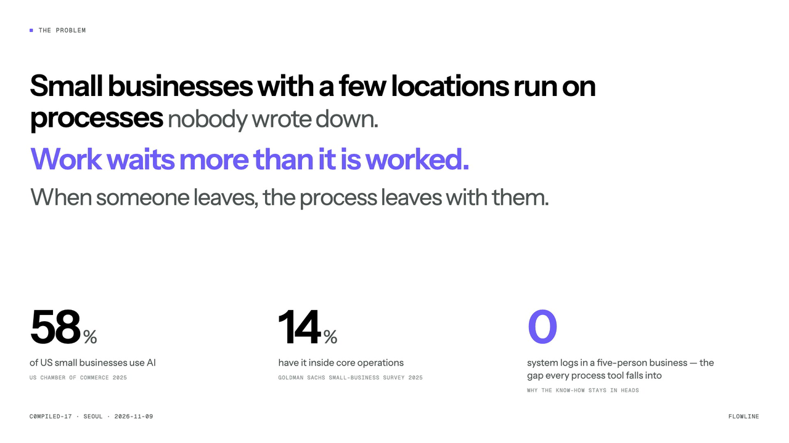<br><sub>The problem, as the film states it: processes nobody wrote down; work waits more than it is worked.</sub></td>
<td width="50%">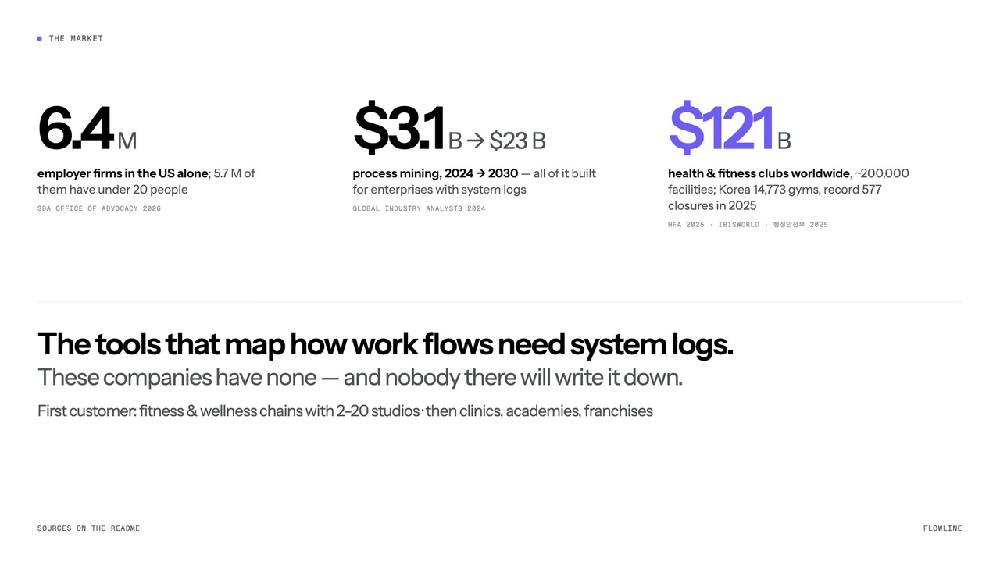<br><sub>6.4 M firms, a $3.1 B → $23 B tool market built for enterprises with system logs, a $121 B first vertical.</sub></td>
</tr>
</table>

Sources are linked in [§11](#11-sources).

## 2. What Flowline is

**Who it is for, and why.** A multi-site service business runs on processes nobody has written down. Work spends most of
its time waiting (78 % of a proposal's cycle in our simulated chain), nobody can see where, and when a person leaves,
the process leaves with them. Every tool that could fix this needs a system log the business does not have — or a
person to write it all down, which nobody will.

**What it is, as a category.** Not an ERP and not a personal assistant: a company-level agent — multiplayer AI in the
sense of Instinct, Grokbot or Pickle. Many people's approved work flows into one shared hub; the hub finds the
bottleneck, proposes the fix on a dashboard everyone can see, brings the proposal to the person it affects first,
and, when they say yes, does the work on their screen.

**The loop.** Collect → learn → find waits → test plans → propose to the person it affects → do the work with consent →
measure.

1. **Collect.** A local agent on each person's computer drafts how their day actually went. The person reviews it at
   18:00, removes anything personal (a left-out column shows what Flowline already kept back), and approves. The approved
   record is signed on the device and sent to the hub. Nothing else leaves.
2. **Learn.** Approved records become one company knowledge — roles, steps, hand-offs, waits — learned, not drawn.
3. **Find waits.** The hub shows where work waits, to scale, per process, and which wait is longest.
4. **Test plans.** Flowline-1 replays the same team, the same requests and the same luck under each candidate plan
   (9 plans × 20 seeds, common random numbers) and ranks them.
5. **Propose.** The board shows the winning plan; the people it touches see only their part, in their own surface — a
   notch banner, an inbox approval, a line on a phone.
6. **Do, with consent.** On "Do it", an agent does the repeated step on that person's desk and leaves the result for
   them to check. Nothing is saved or sent outside without a person.
7. **Measure.** Records after the change are compared with the prediction; the model is recalibrated every night.

One knowledge, many surfaces: a line on the CEO's phone, one approval in Finance's inbox, a notch banner for the
branch manager, an end-of-day review for staff. Only the expansion lead opens a full board.

## 3. Architecture

<p align="center">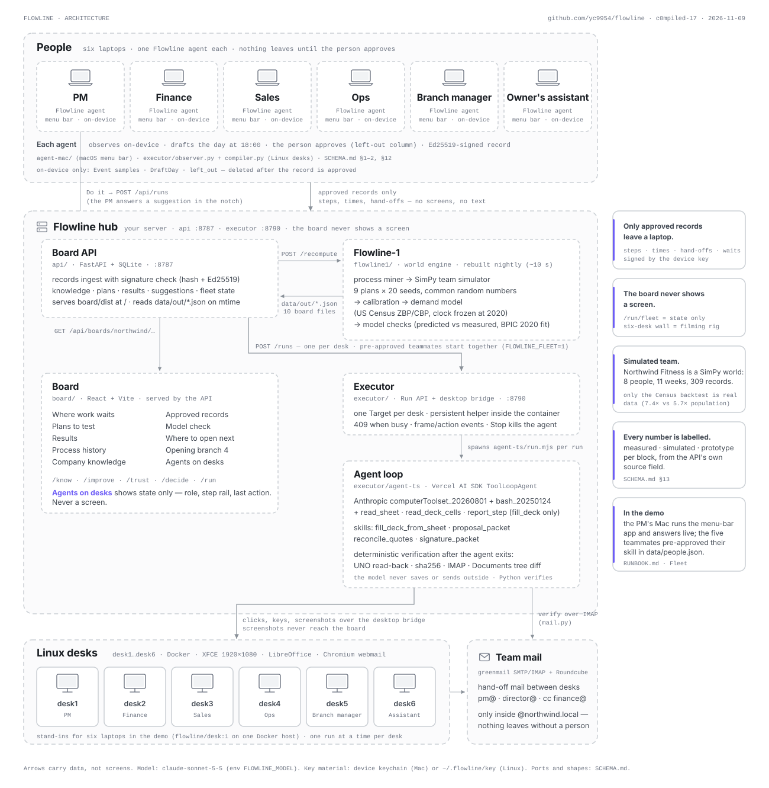</p>

| Dir | What | Run (see [RUNBOOK.md](RUNBOOK.md)) |
|---|---|---|
| `agent-mac/` | macOS menu-bar agent (Swift): on-device observer, privacy filter, end-of-day review, Ed25519 device key, signed record, notch, "Do it" → run view | `cd agent-mac && scripts/bundle.sh && open build/Flowline.app --args --demo-day --eod-now` |
| `api/` | Board API — FastAPI + SQLite, port 8787: records ingest with signature check, knowledge, plans, results, suggestions, runs proxy, fleet state; serves `board/dist` at `/` | `cd api && uv run uvicorn api.main:app --port 8787` |
| `flowline1/` | Flowline-1, the world engine: process miner → SimPy team simulator → calibration → demand model (US Census) → model checks; also the BPIC 2020 fit | `cd flowline1 && uv run python -m flowline1 build --out ../data/out --seed 15` (~10 s) |
| `board/` | Board — React + Vite. Routes: `/know/waits` · `/know/knowledge` · `/know/records` · `/improve/plans` · `/improve/results` · `/improve/history` · `/trust/model` · `/decide/expand` · `/decide/opening` · `/run/fleet` · `/surfaces` | `cd board && FLOWLINE_API=http://localhost:8787 pnpm dev` |
| `executor/` | Executor — Run API + desktop bridge, port 8790 (one Target per desk, persistent helper, 409 when busy, frame/action events); `agent-ts/` agent loop; skills; observer, compiler, actor, measurement | `cd executor && uv run uvicorn main:app --port 8790` |
| `executor/agent-ts/` | Agent loop — Vercel AI SDK `ToolLoopAgent`, Anthropic `computerToolset_20260801` + `bash_20250124`, per-skill prompts in `skills.mjs` | `cd executor/agent-ts && npm install` (Node ≥ 24) |
| `scripts/` | Six Linux desks and team mail on the Docker host | `scripts/desks.sh up 6` · `scripts/mail.sh up && scripts/mail.sh seed` |
| `data/` | `out/` model output (the 10 board files + answer key), `runs/` executor runs and measurements, `people.json` (the fleet), `raw/` datasets (ignored by git) | — |
| `fixtures/` | Prototype data in the shared shapes, used until the model has computed real numbers | — |
| `design/` | Storyboard screens (`.dc.html`) and design notes. Reference only | — |
| `video/` | The 90-second film: script, recorders, supers, voice, build | `cd video && python3 build.py` |

Shared contract: [SCHEMA.md](SCHEMA.md) — every shape, the canonical hash and signature, and the honest-label rule.
Component notes: [api/NOTES.md](api/NOTES.md), [flowline1/NOTES.md](flowline1/NOTES.md), [executor/NOTES.md](executor/NOTES.md),
[executor/skills/README.md](executor/skills/README.md), [executor/MAIL.md](executor/MAIL.md), [agent-mac/NOTES.md](agent-mac/NOTES.md).

## 4. Privacy model

- **On-device first.** The agent samples activity once a second (app, hashed/masked window title, file hint, idle,
  optionally the browser host) into a store that never leaves the machine and is deleted after the day's record is
  approved (SCHEMA §1).
- **Approval before anything leaves.** At 18:00 the agent drafts the day as steps. The person renames, merges, removes
  or unticks steps. Only what they approve is sent.
- **Left-out column.** Personal chat, banking and names in file names are recognised on the device (denylist + name
  masking) and shown as *left out* — counted as away, removed, or renamed — so the person sees what was kept back.
  Measured on a planted day: **0 of 3** planted items reached the record ([`data/runs/privacy.json`](data/runs/privacy.json)).
- **Signed records.** Each record carries a SHA-256 over its canonical JSON and an Ed25519 signature from a device key
  (macOS keychain, or `~/.flowline/key` on Linux). The API verifies both before accepting; a withdrawn record stays on the
  device (SCHEMA §12).
- **The board never shows a person's screen.** `/run/fleet` (*Agents on desks*) shows who is on which step and what was
  left for them to check — never a frame. The six-desk wall in the demo film is a filming rig (`video/wall.html`)
  pointed at the test desktops; it is not a page of the product, and the live-frame endpoint it uses is a
  development/filming aid (`?frames=1`).
- **Agents' screenshots.** The execution agent sees 1280×720 screenshots of the desk it works on; they go to the model
  and to that run's folder on the executor host (`data/runs/<id>/`, ignored by git). They are never served to the board.
- **Hand-off mail stays internal.** The only mail an agent sends is the hand-off inside the approved plan
  (pm@, director@, cc finance@ on `@northwind.local`); the prompt forbids any address outside that domain, and the
  verification checks the recipient.
- **Nothing outside without a person.** Decks are left modified and unsaved for the person to check; the exported PDF
  waits in *For signature/*; a run can be stopped at any time (Stop honoured in 2.1 s, measured).

## 5. The test case: Northwind Fitness (simulated)

Northwind Fitness is a simulated chain — three clubs in Austin, TX, 28 people, of whom eight office roles (Sales ×2,
PM, Design ×2, Finance, Director, Legal) record their days. The process under test is the corporate proposal.

**What was simulated (Flowline-1, `flowline1/flowline1/world.py`).** Eleven weeks, eight people, **309 approved records**
(one per person per working day with activity), every hand-off and every wait, on a SimPy world engine with hidden
truth (the Director batches sign-offs once a day at ~18:00; 71 % of quotes are under $5k; review send-backs for
figures, layout and wording; a second process — membership renewals — in the same records). The miner, simulator,
plans, results, history and opening pages are all computed from those records, not scripted. The hidden truth is used
only by `flowline1 check`.

**What is real.** The demand model's backtest runs on US Census data (County/ZIP Business Patterns 2014–2023, ACS
2015–19): clock frozen at 2020, 20,937 cold-start ZIP codes scored, outcome read off 2023. The BPIC 2020 fit runs on
the real TU/e event log. Everything on the board is labelled per block with its `source` (measured / simulated /
prototype) from the API.

<table>
<tr>
<td width="50%">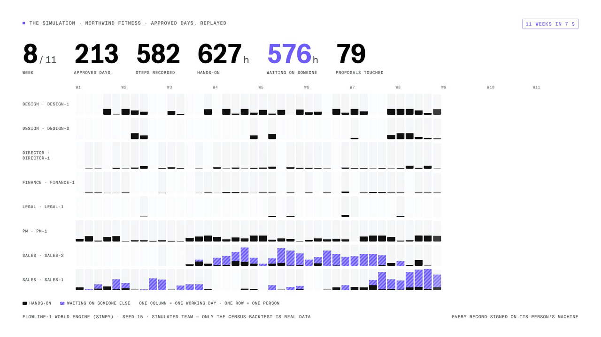<br><sub>Simulated: 55 working days × 8 people fill in; the counters are the records' own totals.</sub></td>
<td width="50%">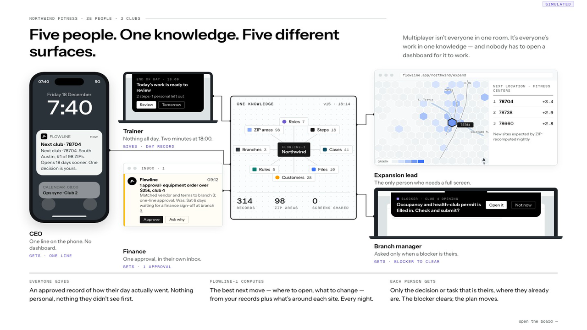<br><sub>One knowledge, five surfaces — what each person gives and gets (prototype data on this screen).</sub></td>
</tr>
</table>

## 6. Results

### What a person sees

<table>
<tr>
<td width="33%">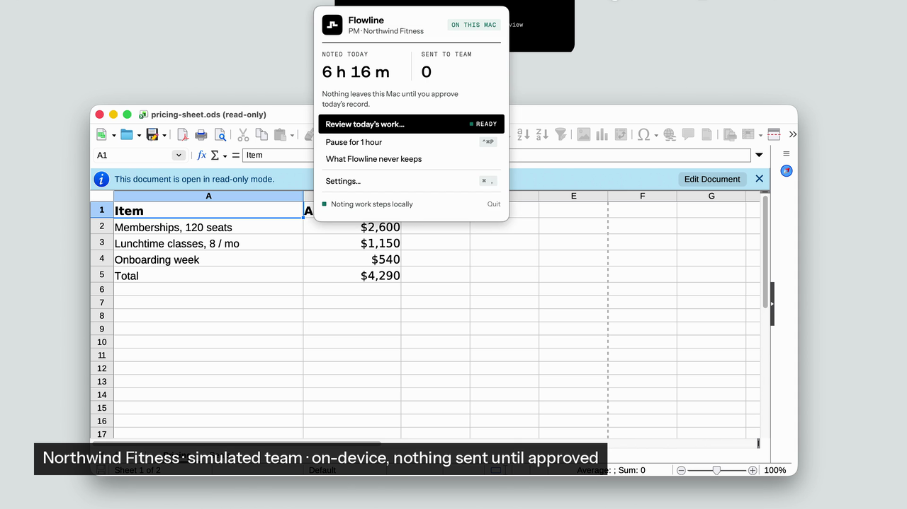<br><sub>18:00 on the Mac: "Your day is drafted · 7 items · Review". Nothing has left the laptop.</sub></td>
<td width="33%">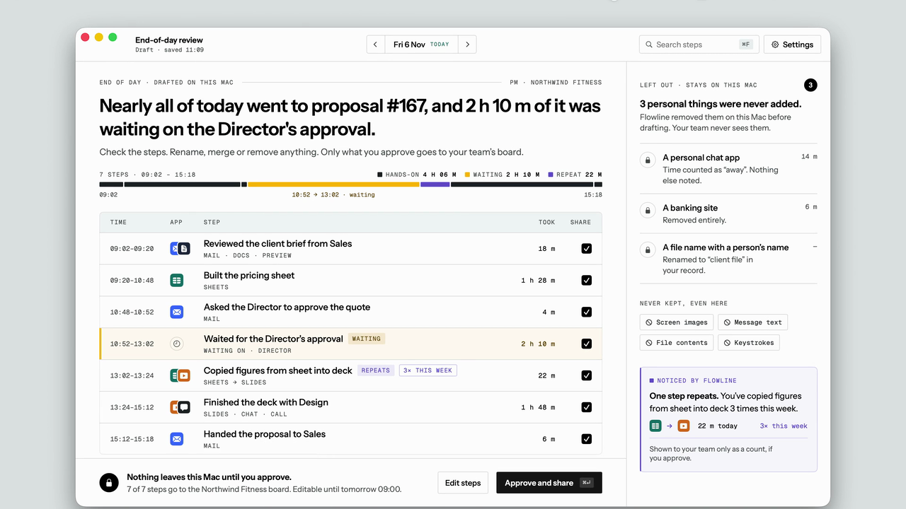<br><sub>The review: steps on the left, the left-out column on the right; Approve signs and sends the record.</sub></td>
<td width="33%">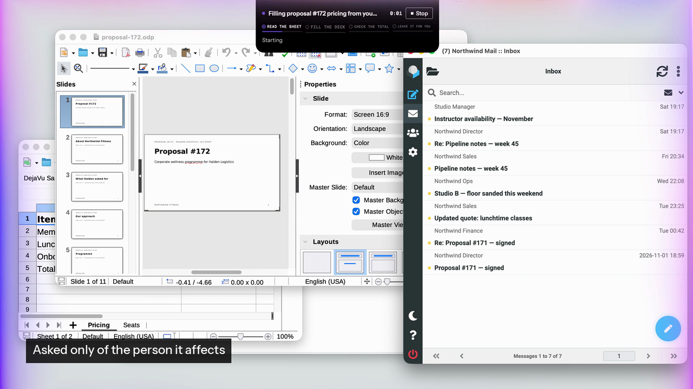<br><sub>A suggestion asked only of the person it affects; "Do it" starts the run on their desk.</sub></td>
</tr>
</table>

### What the company sees

<table>
<tr>
<td width="33%">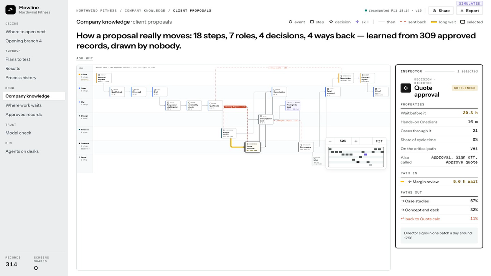<br><sub>/know/knowledge — 18 steps, 7 roles, 4 decisions, 4 ways back, learned from 309 records (simulated).</sub></td>
<td width="33%">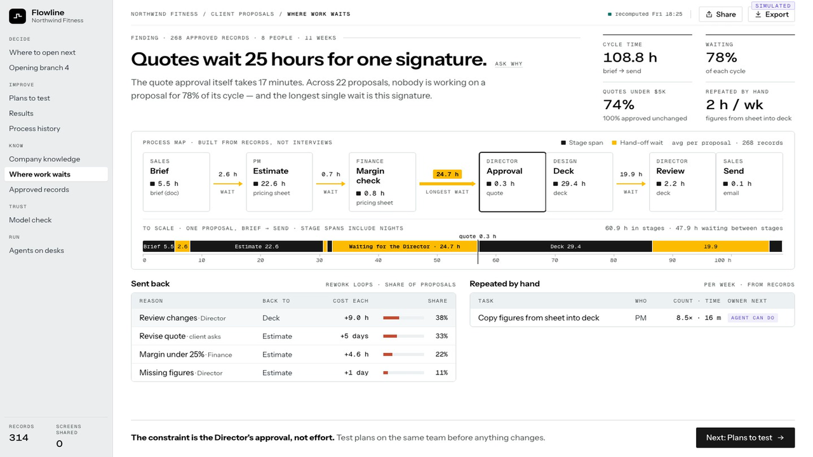<br><sub>/know/waits — quotes wait 25 h for one 17-minute signature; 78 % of a cycle is waiting (simulated).</sub></td>
<td width="33%">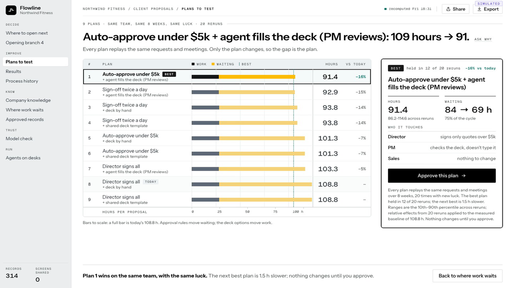<br><sub>/improve/plans — 9 plans on the same team with the same luck; the best held in 12 of 20 reruns (simulated).</sub></td>
</tr>
<tr>
<td width="33%">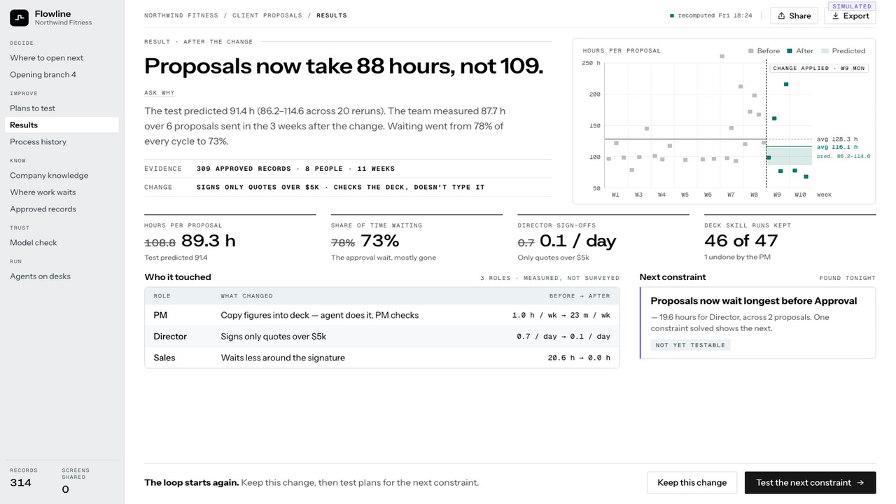<br><sub>/improve/results — 108.8 h → 87.7 h measured in the world, 91.4 h predicted (simulated).</sub></td>
<td width="33%">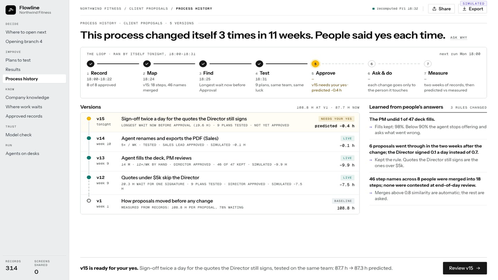<br><sub>/improve/history — three changes in eleven weeks, each with a yes; v15 waits for one (simulated).</sub></td>
<td width="33%">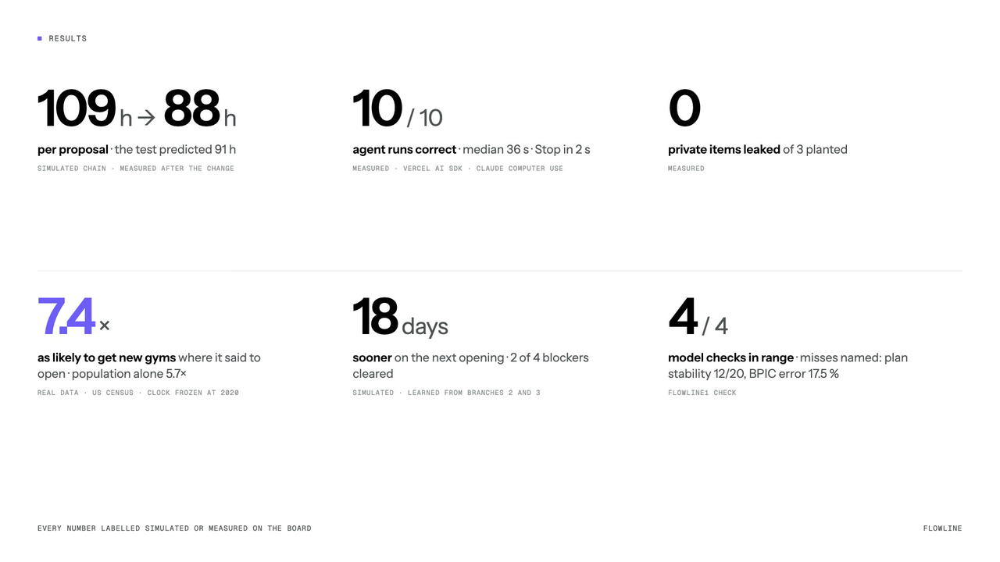<br><sub>The film's results card: six numbers, each labelled simulated, measured or real data.</sub></td>
</tr>
</table>

No still of `/run/fleet` (*Agents on desks*) was captured; it shows state only — role, step rail, last action.

### The demo

<table>
<tr>
<td width="50%">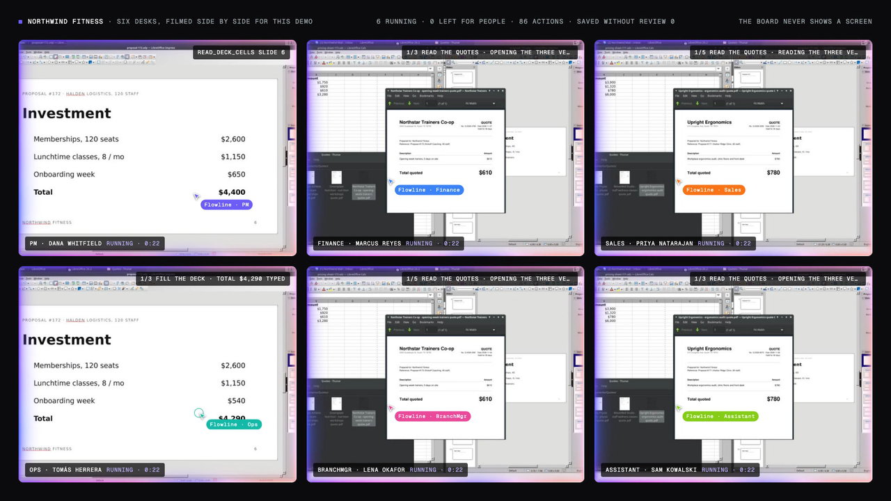<br><sub>Filming rig, 22 s after one "Do it": six desks, six jobs, six agents running (measured take, 2026-11-09 13:24 KST).</sub></td>
<td width="50%">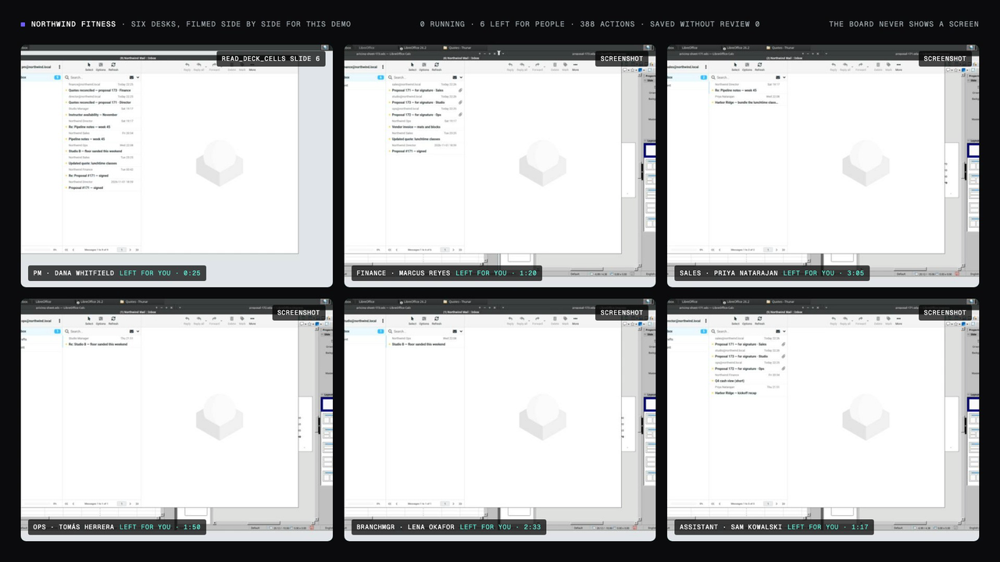<br><sub>Seven minutes later: every run ended "left for you"; nothing saved or sent outside without a person.</sub></td>
</tr>
</table>

### The numbers, honestly

**Process (simulated world, `data/out`)**

| | Before | After | Note |
|---|---|---|---|
| Hours per proposal (median) | 108.8 h | **87.7 h** | measured in the world over 6 proposals sent in the 3 weeks after the change; the test predicted 91.4 h (86.2–114.6 across 20 reruns) |
| Share of time waiting | 78 % | **73 %** | the approval wait mostly gone |
| Director sign-offs per day | 0.7 | 0.1 | only quotes over $5k |
| Deck fills kept | — | 46 of 47 | 1 undone by the PM |

Change applied: quotes under $5k skip the Director; the agent fills the deck from the sheet and the PM reviews.

**Model checks (`flowline1 check`, 4 of 4 in range; two targets missed and named)**

- Predicted vs measured after the change: hours per proposal, waiting share, Director sign-offs/day and the remaining
  signature wait all fall inside the 10th–90th percentile of 20 reruns — **4/4**.
- Bottleneck: the hidden constraint (Approval) ranks #1 by wait. Name merging: precision 1.00 / recall 1.00 on 85 names.
- **Miss 1 — plan stability:** the best plan held in **12 of 20** reruns (target 18). The two leading plans differ by
  ~1.5 h on a ~95 h median.
- **Miss 2 — BPIC 2020 fit (real data):** fitted on 2017 (2,240 cases, two departments), tested on 2018 (8,260 cases):
  cycle-time **median error 17.5 %** (target ≤ 15 %), P80 error 4.1 %.
- Calibration of the baseline: the simulator's own baseline is 5.8 % high (115.2 h vs 108.8 h measured in the world);
  plans are reported as relative effects on the measured baseline. The Director sign-offs/day fit is 19 % off.

**Demand model backtest (real data, US Census)**

The top decile of ZIPs ranked by Flowline-1 in 2020 gained 3+ new businesses by 2023 **7.4×** as often as the average
ZIP (CI 7.1–7.7) for fitness centers, against **5.7×** for ranking by population alone. Coffee and snack bars 6.0× vs
5.1×; physician offices 5.4× vs 5.5× — a tie, shown on the board as "no edge", not hidden. Pooled 6.3× vs 5.2×.

**Execution agents (measured, `data/runs/`, model `claude-sonnet-5-5`)**

| Skill | Runs | Passed | Median | Notes |
|---|---|---|---|---|
| `fill_deck_from_sheet` | 10 | **10/10** | **36.5 s** (P90 40.3 s) | four cells exact, items sum = total, file sha256 unchanged, deck left modified; Stop honoured in 2.1 s. `measure.json` |
| `proposal_packet` | 2 | 2/2 | 517 s (357 s, 677 s) | pre-mail version (NOTE.txt hand-off), desk1; the long run lost ~4 min to a foreign run on the same desk. `measure-proposal_packet.json` |
| `signature_packet` | 1 | 1/1 | 603 s | mail hand-off; PDF to director@ cc finance@ byte-identical to the export. `measure-signature_packet.json` |
| `reconcile_quotes` | 1 | 1/1 | 173 s | sheet row corrected and saved, mail to pm@. `measure-reconcile_quotes.json` |

The measure files hold the passing runs they were assembled from (`measure.py --from-runs`); the run log of the same
morning (`data/runs/run-*.json`) also holds **8 failed packet runs** on desks 4–6 between 11:08 and 11:52. Four ended
in about 80 s with nothing done — a desk-staging problem: the desk had not been dressed (no Calc, Impress or Thunar
window, the UNO soffice not up), and the agent, told not to launch apps itself, stopped and said so without typing,
exporting or sending anything. Four ended at HAND IT OVER with "hand-off mail not
received": the agent attached the file with Enter or a double-click in the GTK file chooser, which in this Chromium 156 +
GTK 3.24 combination closes the dialog without handing the file to the page. Root cause and fix are in
[executor/MAIL.md](executor/MAIL.md): press ctrl+L, type the path, then **click the Open button**; `scripts/mail.sh
attach-test deskN` proves it. Small samples: the batch was cut short on the integrator's request.

**Privacy test (measured, `data/runs/privacy.json`)** — an actor played the PM's day on desk1 at 10× (382 events, 9
record steps). Planted personal items reaching the signed record: **0 of 3** (a personal chat, a bank login, a name in a
file name → counted as away, removed, renamed). Step-boundary F1 **0.80** (precision 0.667, recall 1.0; target ≥ 0.85
missed — three extra boundaries, all real app switches).

**Fleet (measured, the last take, 2026-11-09 13:24 KST)** — one "Do it" from the PM on the Mac started six runs on six
desks at 13:24:01 (`FLOWLINE_FLEET=1`, the five teammates pre-approved in `data/people.json`): PM `fill_deck_from_sheet`
(desk1, 24 s), Finance `reconcile_quotes` (desk2, 81 s), Sales `proposal_packet` (desk3, 185 s), Ops `signature_packet`
(desk4, 110 s), Branch manager `proposal_packet` (desk5, 153 s), Assistant `reconcile_quotes` (desk6, 77 s) —
**6 of 6 done**, every deterministic check passed (sheet, deck via UNO, PDF text, mail with attachment over IMAP, cc,
nothing else changed). Earlier takes that morning passed fewer; the attach failure above was the cause.

## 7. Repository layout

```
flowline/
├── README.md · RUNBOOK.md · SCHEMA.md     this file, the event-day runbook, the shared data contract
├── agent-mac/        Swift menu-bar app (FlowlineCore: observer, compiler, privacy, signer; notch, review, run view)
├── api/              FastAPI board API (routers: records, boards, plans, suggestions, runs, fleet; canonical hash/sig)
├── board/            React + Vite board (pages: Waits, Knowledge, Records, Plans, Results, History, Model, Expand, Opening, Fleet, Surfaces)
├── flowline1/        world engine: world.py, miner.py, simulator.py, calibrate.py, demand.py, bpic.py, validate.py
├── executor/         Run API (main.py, bridge.py, desktop.py, lo.py, runs.py), skills/, agent-ts/, observer/compiler/actor, measure.py, privacy.py, mail.py
├── scripts/          desks.sh (six Docker desks), mail.sh (greenmail + Roundcube), sync-mini.sh
├── data/             out/ (model output), runs/ (runs + measurements), people.json, mail/, raw/ (ignored)
├── fixtures/         prototype data in the SCHEMA shapes
├── design/           storyboard screens and design notes (reference only)
├── video/            SCRIPT.md, cards.html, wall.html, sim.html, recorders, supers, voice, build.py
└── docs/             this README's architecture diagram and screenshots
```

## 8. Running it

Secrets live in `.env` (ignored by git): `ANTHROPIC_API_KEY`, `FLOWLINE_MODEL` (default `claude-sonnet-5-5`). The
full event-day procedure — the Docker host, tunnels, six desks, team mail, fleet, model rebuild, Mac app, film — is in
[RUNBOOK.md](RUNBOOK.md). The short version on one machine:

```bash
cd flowline1 && uv run python -m flowline1 build --out ../data/out --seed 15   # the 10 board files, ~10 s
cd ../api && uv run uvicorn api.main:app --port 8787                           # board API; serves board/dist at /
cd ../board && pnpm install && pnpm build                                      # or: FLOWLINE_API=http://localhost:8787 pnpm dev
cd ../executor && set -a && source ../.env && set +a && uv run uvicorn main:app --port 8790   # needs a desk (RUNBOOK)
cd ../agent-mac && scripts/bundle.sh && open build/Flowline.app --args --demo-day --eod-now   # macOS
```

Health: `curl localhost:8787/api/health`, `curl localhost:8787/api/boards/northwind/status`, `curl localhost:8790/health`.
Tests: `uv run pytest` in `api/`, `flowline1/` and `executor/`; `swift test` in `agent-mac/`.

## 9. The film

A 90-second film, voice first: problem → market → product → test case → the simulation time-lapse → demo (collect,
learn, act: six desks live, then the whole take at 50×) → results → close. Script, shot list and honest-label rules:
[video/SCRIPT.md](video/SCRIPT.md). Pipeline (`video/`): `supers_from_data.py` reads `data/out` and the measure files
so every number on screen agrees with the data → `vo.py` / `vo_higgsfield.py` (narration) → `record_board.mjs`
(cards and board routes via the CDP screencast) and `record_mac_cuts.sh` (real Mac takes) → `build.py` (crop, supers,
mix, concat → `out/flowline-90s.mp4`). `video/out/` is not committed; the screenshots in this README are frames from
those recordings.

## 10. Honest labels, limits

- Northwind Fitness is a **simulated** team. Its numbers show what the machinery computes from approved records; they
  are not a customer result.
- The Opening page (`/decide/opening`) is a playbook with declared durations from "branches 2 and 3"; it is not learned
  from records (there are no branch-opening records in the world).
- `Surfaces` (`/surfaces`) is a prototype screen of the five-surface idea; the notch, inbox and phone line are mock-ups
  there, while the Mac notch and review are real.
- The Mac backend of the executor (CGEvent clicks and typing) is implemented but was not exercised; all agent runs were
  on the Linux desks.
- No LLM is used anywhere in Flowline-1; step names are resolved by rules. The LLM is used by the execution agent and by
  the compiler's step naming.

## 11. Sources

- US Chamber of Commerce, *Empowering Small Business: The Impact of Technology on U.S. Small Business* (2025) — 58 % of
  small businesses use AI. https://www.uschamber.com/technology/empowering-small-business-the-impact-of-technology-on-u-s-small-business
- Goldman Sachs, *10,000 Small Businesses Voices* survey (2025) — 14 % with AI inside core operations. https://www.10ksbvoices.com/
- SBA Office of Advocacy, *Frequently Asked Questions About Small Business* — 6.4 M employer firms, 5.7 M with under 20
  employees. https://advocacy.sba.gov/
- Global Industry Analysts (StrategyR), *Process Mining — Global Strategic Business Report* — $3.1 B (2024) → $23 B
  (2030). https://www.strategyr.com/
- Health & Fitness Association, *2025 Global Report* — $121 B, ~200,000 facilities. https://www.healthandfitness.org/
- IBISWorld, *Gym, Health & Fitness Clubs* industry reports. https://www.ibisworld.com/
- 행정안전부 지방행정 인허가 데이터 (Korea Ministry of the Interior and Safety, local licence open data) — 14,773 gyms,
  577 closures in 2025. https://www.localdata.go.kr/
- US Census Bureau, *County Business Patterns / ZIP Code Business Patterns* 2014–2023 and *American Community Survey*
  2015–2019 5-year. https://www.census.gov/programs-surveys/cbp.html · https://www.census.gov/programs-surveys/acs
- van Dongen, B.F., *BPI Challenge 2020 — Domestic Declarations*, TU/e, 4TU.ResearchData. https://doi.org/10.4121/uuid:52fb97d4-4588-43c9-9d04-3604d4613b51
- Vercel AI SDK (`ai`, `@ai-sdk/anthropic`). https://ai-sdk.dev · Anthropic computer use tool. https://docs.claude.com/en/docs/agents-and-tools/tool-use/computer-use-tool

## 12. Licence and data attributions

No licence file is included in this commit; all rights reserved until one is added.

Data: BPI Challenge 2020 Domestic Declarations (TU/e) is licensed **CC BY-NC 4.0** and is used here for the demo fit
only, not for training a product. US Census Bureau data (CBP/ZBP, ACS) is public domain. Northwind Fitness, its people,
quotes, decks and mail are fictional and simulated.
